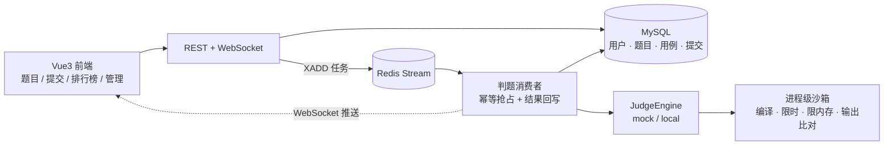

# CodeJudge

在线判题系统（Online Judge）：提交代码 → 异步判题 → 进程级沙箱执行 → 实时推送结果。

前端 Vue 3 + TypeScript，后端 Spring Boot 3 + MyBatis-Plus，判题队列用 Redis Stream，
代码执行在进程级沙箱里完成。

## 架构



一次提交的完整路径：

1. 前端提交代码 → 落库（状态 `PENDING`）→ `XADD` 到 Redis Stream → 立即返回
2. 消费者用条件更新 `PENDING → JUDGING` 抢占任务：同一条消息被重复消费时，
   第二次的更新行数为 0，直接跳过——这是整个幂等机制的支点，比分布式锁简单得多
3. 判题引擎在临时目录里编译、逐用例执行、比对输出
4. 回写终态、更新题目统计与排行榜 → WebSocket 推给前端

## 实测数据

本机实测，复现命令见下文。

| 指标 | 场景 | 结果 |
|---|---|---|
| 题目查询 | 16 并发 × 3200 次（Cache-Aside） | **QPS 1,462**，P50 10.16 ms，P99 25.22 ms |
| 提交接口 | 20 次串行（异步落库 + 入队即返回） | P50 18.49 ms，P99 80.30 ms，0 失败 |
| 判题端到端 | AC / WA / CE / TLE / Python / 排行榜 / 统计 | **12 / 12 通过** |

## 快速开始

### 环境要求

- **JDK 21**（用到虚拟线程、record、switch 表达式）
- **Maven 3.9+**
- **MySQL 8.0**
- **Redis 5.0+**（用到 Redis Stream）
- **Node 20+**（仅前端需要）

### 1. 构建

```bash
mvn -f pom.xml install -DskipTests
```

根 POM 只是仓库级构建入口，真正的多模块结构在 `backend`。

> 用 `install` 而不是 `package`：IDE（IDEA / Eclipse）的 Maven 同步是按模块单独解析的，
> 本地仓库里没有产物就会报「无法解析依赖项」。只用命令行的话 `package` 也够。

### 2. 初始化数据库

```bash
mysql -uroot -p < backend/sql/init.sql
mysql -uroot -p < backend/sql/seed.sql      # 示例题目与测试用例
```

也可以容器起依赖（首次启动自动执行建表与种子脚本）：

```bash
cd backend && docker compose up -d
```

> 本项目对容器的依赖为零：判题用的是进程级沙箱（`ProcessBuilder` + 超时强杀 + `-Xmx`），
> 队列是 Redis Stream。compose 只是给不想在本机装 MySQL / Redis 的人省事。

### 3. 启动

```bash
java -jar backend/cj-web/target/codejudge.jar
```

连接信息在 `backend/cj-web/src/main/resources/application.yml`，
默认 `root/123456`，可用 `DB_USERNAME` / `DB_PASSWORD` 等环境变量覆盖。

### 4. 前端

```bash
cd frontend && npm install && npm run dev    # http://localhost:5173
```

### 5. 复现实测

```bash
python tools/e2e_judge.py        # 判题端到端（需先启动应用）
python tools/bench_codejudge.py  # HTTP 接口压测
```

## 模块

```
codejudge/
├── backend/
│   ├── cj-common     统一响应、业务异常、用户上下文、JWT 工具（不依赖 Spring）
│   ├── cj-model      实体 / DTO / VO / 枚举
│   ├── cj-dao        MyBatis-Plus Mapper
│   ├── cj-service    业务逻辑 + 判题引擎 + 进程级沙箱 + Stream 消费
│   └── cj-web        REST / WebSocket / 配置 / 启动类
├── frontend/         Vue3 + TypeScript + Monaco
├── sql/              建表与种子数据
└── docker-compose.yml
```

依赖方向严格单向：`cj-web → cj-service → cj-dao → cj-model → cj-common`。

> 模块职责与设计取舍见 **[架构文档](docs/ARCHITECTURE.md)**——含 7 张 Mermaid 图（架构、时序、状态机、ER 图）、
> 错误码分段、幂等的三个层次、沙箱的编码一致性等；表结构与索引设计见 **[数据库设计](docs/DATABASE.md)**。

## 设计要点

**异步判题**：提交接口只做落库和入队，判题耗时与 HTTP 请求彻底解耦。
判题几分钟也不影响接口响应。

**幂等抢占**：`UPDATE ... WHERE status='PENDING'` 的影响行数就是抢占结果。
0 行说明别人已经领走了，直接返回。不需要分布式锁，也不会有锁超时和脑裂。

**判题引擎抽象**：`JudgeEngine` 接口有三个分支——`mock`（不执行代码，靠源码里的
`FORCE_CE/FORCE_WA/FORCE_TLE/FORCE_RE` 关键字返回结果，用于联调）、`local`（真实沙箱）。
用 `@ConditionalOnProperty` 互斥装配，启动时只会有一个实例。

**沙箱的边界（不要高估）**：靠 `ProcessBuilder` + `waitFor` 超时强杀 + `-Xmx` 限堆。
拦不住 fork 炸弹、网络访问、越权读文件，也测不准内存峰值——这些需要容器 + cgroup 才能解决。
`CodeSandbox` 接口已经抽出，将来加一个容器级实现即可，上层调用点不用改。

**输出归一化**：比对前统一换行符、去掉整体首尾空白。用户多打一个空格、多用 `\r\n`
都不该判 WA——这些不是算法正确性的体现。

**WA 给出差异**：只给「第 N 个用例失败」，用户没法调试。所以样例用例会回传
期望输出 / 实际输出，隐藏用例只给序号（防止抄答案）；输出为空时额外提示
「检查是否遗漏 print/println」——这是最常见的失败原因。

**缓存可重建**：排行榜是 `user.solved_count` 的派生数据，而 ZSet 只在「首次通过某题」时
增量更新。Redis 一旦清空，增量路径再也不会触发，榜单会永久空着。
所以启动时从数据库全量对齐一次——缓存可以丢，因为丢了能重建。

**编码一致性**：`javac` 的 stderr 跟随平台默认编码（中文 Windows 是 GBK），而读取端是 UTF-8。
不处理的话，编译错误会显示成 `????`。解法是强制英文诊断（纯 ASCII 不受解码影响），
运行时则统一指定 `-Dstdout.encoding=UTF-8` / Python 的 `-X utf8`。

## 已知边界

- **沙箱是进程级**，不是容器级：隔离强度有限，见上文
- **判题并发缺陷**：`solved_count` 的「首次通过」判断在并发提交下可能重复 +1，
  修法是按 `(userId, problemId)` 加分布式锁
- **只支持 Java 和 Python**：分别代表编译型与解释型两条流程，验证抽象够用即可
- **单机部署**：没有做多实例的消费者归属治理（`consumer-name` 需手动错开）

## License

[MIT](LICENSE)
