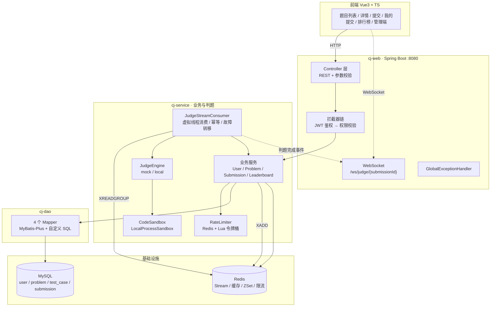
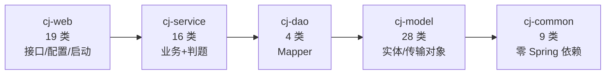
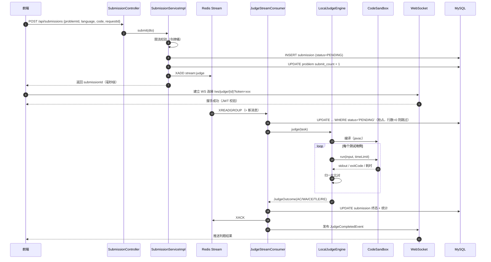
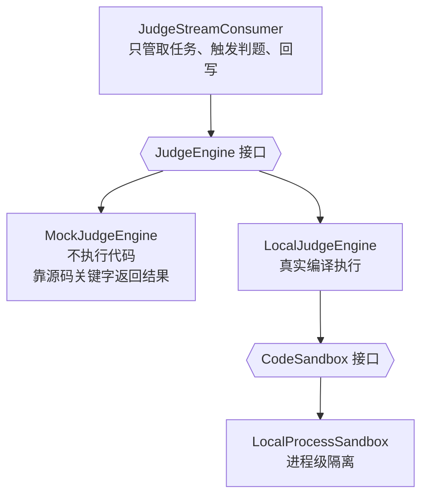
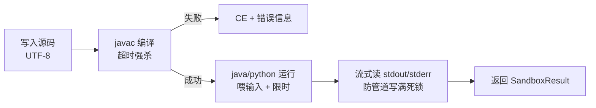
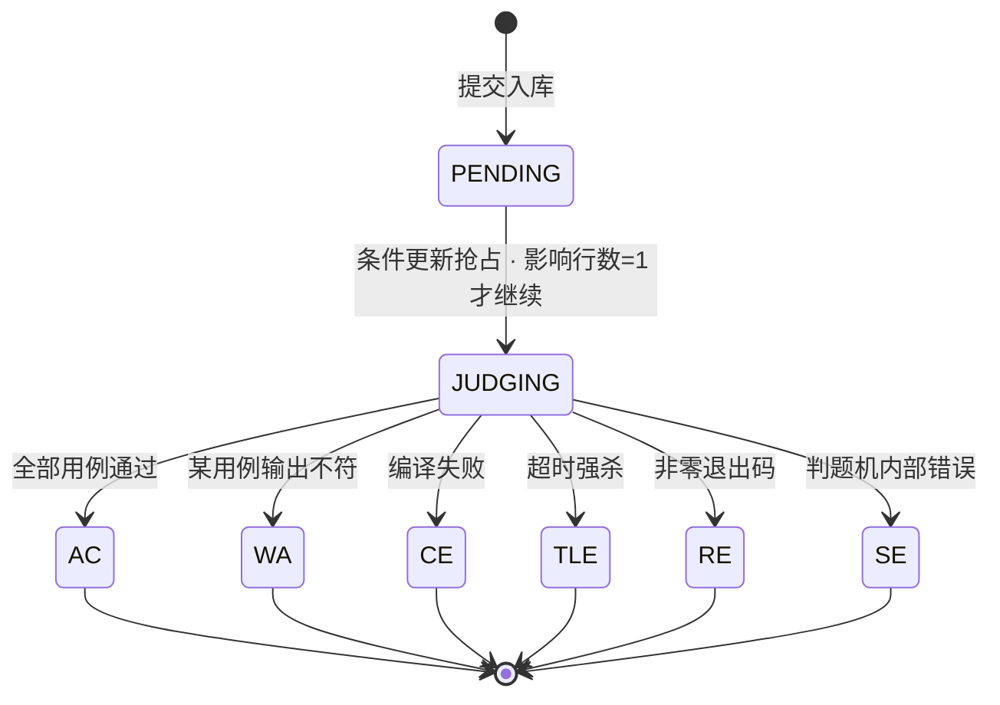
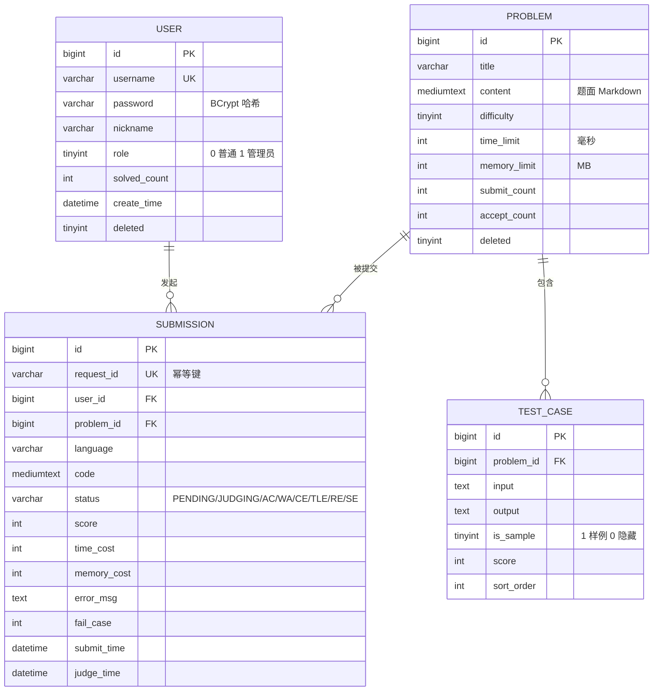

# CodeJudge 架构与技术文档

> 在线判题系统。提交代码 → 异步判题 → 进程级沙箱执行 → 实时推送结果。
>
> 本文档按「模块」组织，每个模块说明职责、结构、关键实现与设计取舍。
> 所有代码片段都来自当前仓库，图使用 Mermaid（GitHub / IDEA 均可渲染）。

## 目录

1. [系统概览](#一系统概览)
2. [一次提交的完整生命周期](#二一次提交的完整生命周期)
3. [模块详解](#三模块详解)
   - [3.1 cj-common](#31-cj-common基础能力)
   - [3.2 cj-model](#32-cj-model数据模型)
   - [3.3 cj-dao](#33-cj-dao数据访问)
   - [3.4 cj-service](#34-cj-service业务与判题)
   - [3.5 cj-web](#35-cj-web接口与配置)
4. [关键流程专题](#四关键流程专题)
5. [数据模型](#五数据模型)
6. [已知边界与技术债](#六已知边界与技术债)
7. [技术点索引](#七技术点索引)

---

## 一、系统概览

### 1.1 技术栈

| 层次 | 技术选型 | 版本 |
|---|---|---|
| 运行时 | JDK（虚拟线程） | 21 |
| 框架 | Spring Boot | 3.3.5 |
| 持久层 | MyBatis-Plus | 3.5.9 |
| 数据库 | MySQL | 8.0 |
| 缓存 / 队列 | Redis（Stream、ZSet、Lua） | 5.0+ |
| 鉴权 | JJWT（HS256） | 0.12.6 |
| 实时推送 | WebSocket（Spring WebSocket） | — |
| 前端 | Vue 3 + TypeScript + Monaco | 3.5 / 5.4 |

### 1.2 整体架构



**三个关键分层决策**：

| 决策 | 原因 |
|---|---|
| 判题不进 HTTP 请求 | 判题耗时从几百毫秒到几秒不等，同步执行会把 Tomcat 线程池占满，一次判题风暴就能让题目列表页打不开 |
| 队列选 Redis Stream 而不是 MQ | 已依赖 Redis；Stream 自带消费者组、PENDING 列表和 XCLAIM，够用且少一个中间件 |
| 沙箱走进程级而非容器 | 本机无 Docker 且 Windows 上容器起停开销大；用 `CodeSandbox` 接口留出替换空间 |

### 1.3 模块依赖



依赖严格单向，没有循环。`cj-common` 不依赖 Spring，因此可以被任何模块安全引用（包括将来可能的独立进程）。

---

## 二、一次提交的完整生命周期



**为什么返回这么快**：提交接口只做「校验 + 落库 + 入队」三件事，判题完全异步。实测 P99 80.30 ms。

---

## 三、模块详解

### 3.1 cj-common：基础能力

**定位**：全项目共享的"最小公约数"——结果封装、异常、用户上下文、JWT。刻意**不引入任何 Spring 依赖**。

#### 类清单

| 类 | 职责 | 关键点 |
|---|---|---|
| `Result<T>` | 统一响应体 | `code` / `message` / `data` / `timestamp` |
| `ResultCode` | 错误码枚举 | 分段编码，见下表 |
| `PageResult<T>` | 分页响应 | `records` / `total` / `page` / `size` |
| `BizException` | 业务异常 | 携带 `ResultCode`，由全局处理器统一转换 |
| `UserContext` | 当前用户上下文 | `ThreadLocal` + 必须清理 |
| `CurrentUser` | 用户快照 | record：`id` / `username` / `role` / `isAdmin()` |
| `JwtUtil` | JWT 签发与解析 | 纯 Java 类，非 Bean |
| `AuthConstants` | 认证常量 | `TOKEN_HEADER` / `TOKEN_PREFIX` |
| `@RequireAdmin` | 权限注解 | 方法优先于类 |

#### 错误码设计

采用**分段编码**，前端可以按区间做粗粒度处理：

| 段 | 含义 | 示例 |
|---|---|---|
| 0 / 4xx / 5xx | 通用结果 | `0` 成功、`400` 参数错误、`401` 未登录、`403` 无权限、`500` 系统异常 |
| 1xxx | 用户与认证 | `1001` 用户名已注册、`1002` 密码错误、`1003` 用户不存在、`1004` 凭证无效、`1005` 登录过期 |
| 2xxx | 题目 | `2001` 题目不存在 |
| 3xxx | 提交 | `3001` 提交过于频繁、`3002` 提交记录不存在 |

`1004` 和 `1005` 分开是关键：前端拿到 `1005` 可以静默跳登录页，拿到 `1004` 则要提示"请重新登录"，用户体验完全不同。

#### JwtUtil：为什么不是 Spring Bean

```java
/**
 * 刻意做成普通 Java 类而不是 Spring Bean —— 这样 cj-common 不依赖 Spring，
 * 在 cj-web 里通过 @Bean 装配。分层更干净，也方便写单元测试。
 */
public class JwtUtil {
    private final SecretKey key;
    private final long expireSeconds;

    public JwtUtil(String secret, long expireSeconds) {
        this.key = Keys.hmacShaKeyFor(secret.getBytes(StandardCharsets.UTF_8));
        this.expireSeconds = expireSeconds;
    }
}
```

在 `cj-web/config/AppConfig` 里用 `@Bean` 装配。好处：`cj-common` 的 `pom.xml` 里没有 `spring-boot`，编译期就杜绝了"顺手注入个 Bean"的可能。

#### 签发与解析

```java
public String generate(Long userId, String username, Integer role) {
    Instant now = Instant.now();
    return Jwts.builder()
            .subject(String.valueOf(userId))
            .claim("username", username)
            .claim("role", role)
            .issuedAt(Date.from(now))
            .expiration(Date.from(now.plusSeconds(expireSeconds)))
            // 显式指定 HS256：不指定的话 jjwt 会按密钥长度自动升级算法，
            // 一旦密钥长度变化，算法跟着变，多实例部署时可能校验失败
            .signWith(key, Jwts.SIG.HS256)
            .compact();
}
```

**为什么把 role 塞进 token**：鉴权时不需要查库，纯无状态。代价是**角色变更要等 token 过期才生效**（当前 24 小时）。

#### UserContext：ThreadLocal 的坑

```java
public final class UserContext {
    private static final ThreadLocal<CurrentUser> HOLDER = new ThreadLocal<>();

    public static CurrentUser require() {
        CurrentUser user = HOLDER.get();
        if (user == null) {
            throw new BizException(ResultCode.UNAUTHORIZED);
        }
        return user;
    }

    public static void clear() { HOLDER.remove(); }
}
```

**必须在 `afterCompletion` 里调用 `clear()`**。Tomcat 线程池复用线程，不清理会把上一个请求的用户身份带给下一个请求——这是最典型的越权 bug。

### 3.2 cj-model：数据模型

**定位**：所有"数据长什么样"的定义。共 28 个类，按用途分五组。

| 包 | 数量 | 作用 | 例子 |
|---|---|---|---|
| `entity` | 4 | 数据库表的直接映射（MyBatis-Plus） | `User` / `Problem` / `TestCase` / `Submission` |
| `dto` | 7 | 接收前端入参，带校验注解 | `RegisterDTO` / `SubmitDTO` / `ProblemSaveDTO` |
| `vo` | 10 | 返回给前端的视图对象 | `ProblemListVO` / `SubmissionVO` / `LeaderboardVO` |
| `enums` | 2 | 枚举 | `Language` / `SubmissionStatus` |
| `judge` | 5 | 判题领域内对象 | `JudgeOutcome` / `SandboxResult` / `JudgeTask` |

#### 为什么 entity / dto / vo 三套分开

最省事的做法是"一张表一个类，前后端都用它"，但这样会出事：

| 问题 | 具体表现 |
|---|---|
| **泄漏隐藏数据** | `Problem` 实体带 `content`（题面），列表接口如果直接返回实体，一页 10 题就是几百 KB 的无用传输 |
| **泄漏敏感字段** | `User` 实体带 `password`（BCrypt 哈希），直接序列化就出去了 |
| **隐藏用例泄漏** | `TestCase` 的 `isSample=0` 是判题用的隐藏用例，绝不能出现在题目详情接口里 |

所以每个接口都用自己的 VO，字段是"这个场景该给什么"的白名单，而不是实体的黑名单（`@JsonIgnore` 那种漏一个就完蛋）。

#### judge 包：判题领域的值对象

```java
/**
 * 判题结果。record 而非普通类：判题结果一旦产生就不该被修改，
 * 用不可变对象从类型上杜绝"判完之后又被改"的可能。
 */
public record JudgeOutcome(
        SubmissionStatus status,
        int score,
        Integer timeCost,
        Integer memoryCost,
        String errorMsg,
        Integer failCase
) {
    public static JudgeOutcome wrongAnswer(int score, int timeCost, int memoryCost,
                                           int failCase, String detail) { ... }
}
```

`SandboxResult` 是沙箱对单次执行的返回（`stdout` / `stderr` / `exitCode` / `timeCostMs`），`SandboxStatus` 是沙箱层的状态（比提交状态更细，区分 `COMPILE_ERROR` 和 `INTERNAL_ERROR`）。

**分层的意义**：沙箱只管"跑出什么"，引擎负责"跑出来的东西算不算对"，服务层负责"结果怎么落库"。三层各管一段，任何一层出问题都能独立替换。

---

### 3.3 cj-dao：数据访问

**定位**：4 个 MyBatis-Plus Mapper，没有一行 XML。

```java
public interface UserMapper extends BaseMapper<User> {
    @Update("UPDATE `user` SET solved_count = solved_count + 1 WHERE id = #{userId}")
    int increaseSolvedCount(@Param("userId") Long userId);
}
```

#### 全部自定义 SQL 就三条

| Mapper | 方法 | 语义 |
|---|---|---|
| `ProblemMapper` | `increaseSubmitCount` | `submit_count = submit_count + 1` |
| `ProblemMapper` | `increaseAcceptCount` | `accept_count = accept_count + 1` |
| `UserMapper` | `increaseSolvedCount` | `solved_count = solved_count + 1` |

三条都是**数据库端原子自增**，不是"查出来 +1 再写回"。

**为什么必须这样写**：`x = x + 1` 由数据库在行锁内完成，天然并发安全；如果写成 Java 里 `int c = p.getCount(); p.setCount(c + 1);`，两个并发请求会都读到旧值，最后只加了一次。

#### 其余靠 MyBatis-Plus

- 单表 CRUD 用 `BaseMapper`
- 分页用 `IPage` + `PaginationInnerInterceptor`（`MybatisPlusConfig` 里配置）
- 逻辑删除靠 `@TableLogic`（`deleted` 字段），所有查询自动带 `deleted = 0`

**注意**：Mapper 本身只提供标准 CRUD。分页的两种模式都在 **Service 层组装**
（`SubmissionServiceImpl.mySubmissions`）：

- **offset 分页**：`selectPage` + `Page`，适合"跳到第 N 页"；
- **游标分页**：`WHERE (submit_time, id) < (lastTime, lastId) + LIMIT size+1`，
  适合无限滚动。多取一条判断 `hasMore`，不额外 `COUNT`。

游标分页解决的是深分页退化：`LIMIT 100000, 15` 实际要读出 100015 条再丢弃前 10 万条，
而游标直接按索引定位起点，耗时与页码无关。

---

### 3.4 cj-service：业务与判题

**定位**：项目里最厚的一层，16 个类承担全部核心逻辑。

```
service/
├── UserService / ProblemService / SubmissionService / LeaderboardService   接口
├── impl/   UserServiceImpl / ProblemServiceImpl / SubmissionServiceImpl    实现
├── judge/  判题域（引擎 + 沙箱 + 队列 + 消费者）                          ★ 核心
└── ratelimit/RateLimiter                                                   限流
```

#### 3.4.1 判题引擎：三层抽象



两个实现通过配置互斥装配：

```java
@Bean
@ConditionalOnProperty(name = "codejudge.judge.engine", havingValue = "mock")
public JudgeEngine mockJudgeEngine() { return new MockJudgeEngine(); }

@Bean
@ConditionalOnProperty(name = "codejudge.judge.engine", havingValue = "local", matchIfMissing = true)
public JudgeEngine localJudgeEngine(...) { return new LocalJudgeEngine(...); }
```

`matchIfMissing = true` 让 `local` 成为默认值——不配任何东西也能跑真实判题。

**`MockJudgeEngine` 的价值**：它按源码里是否包含 `FORCE_CE` / `FORCE_WA` / `FORCE_TLE` / `FORCE_RE` 关键字返回对应结果。这样测队列、幂等、回写、WebSocket 推送时，**不需要真的编译运行代码**，链路测试从"秒级"变成"毫秒级"，也不依赖本机装了 JDK。

#### 3.4.2 进程级沙箱

`LocalProcessSandbox` 的核心是四个环节：



**四个必须处理的细节**：

**① 喂完输入立刻关流**

```java
try (OutputStream os = p.getOutputStream()) {
    os.write(input == null ? new byte[0] : input.getBytes(StandardCharsets.UTF_8));
}   // try-with-resources 自动 close，否则程序一直阻塞等 stdin
```

**② 两个独立线程读 stdout 和 stderr**

```java
// 避免 stdout/stderr 任一被写满导致进程阻塞（经典死锁）
StreamReader outReader = new StreamReader(p.getInputStream());
StreamReader errReader = new StreamReader(p.getErrorStream());
```

只读一个流是常见错误：子进程往另一个流写了超过 64KB（管道缓冲区），就会阻塞在 write 上永远不退出。

**③ 超时必须强杀**

```java
finished = p.waitFor(timeLimitMs + 500, TimeUnit.MILLISECONDS);
if (!finished) {
    p.destroyForcibly();        // SIGKILL，比 destroy 彻底，避免残留子进程
    p.waitFor(2, TimeUnit.SECONDS);
}
```

留 500ms 缓冲，避免"刚好压线"的程序被时钟误差误杀。

**④ 编码必须钉死**

```java
cmd.add("-J-Duser.language=en");   // 强制英文诊断，纯 ASCII 不受解码方式影响
cmd.add("-J-Duser.country=US");
```

不写这两行的话，中文 Windows 上 `javac` 用 GBK 输出诊断，而读取端按 UTF-8 解码，编译错误会变成 `????`。

**它拦不住什么**（写进类注释了）：

- fork 炸弹（没有 pids limit）
- 网络访问（没有网络隔离）
- 越权读文件（没有文件系统隔离）
- 内存峰值测不准（`-Xmx` 只能限制堆，`memoryCost` 实际返回 0）

这些需要容器 + cgroup + seccomp。`CodeSandbox` 接口已经抽出，加一个容器级实现即可，`LocalJudgeEngine` 一行不用改。

#### 3.4.3 判题队列：Redis Stream

**常量定义**（`JudgeQueue`）：

```java
public static final String STREAM_KEY = "stream:judge";
public static final String GROUP      = "judge-group";
public static final long   MAX_LEN    = 10_000L;   // XADD MAXLEN ~ 近似修剪
```

**消费者启动**（`JudgeStreamConsumer.start`）：

```java
for (int i = 0; i < Math.max(1, concurrency); i++) {
    String name = consumerName + "-" + i;
    // JDK 21 虚拟线程：消费循环大部分时间在等 Redis IO，用虚拟线程几乎零成本
    Thread t = Thread.ofVirtual().name("judge-consumer-" + name).start(() -> loop(name));
    workers.add(t);
}
```

**这里踩过一个坑**：`XGROUP CREATE` 要求 Stream 必须已存在，而 Spring Data Redis 的 `createGroup` 不带 `MKSTREAM`。首次启动时 Stream 是空的，建组必失败，导致消息永远没人消费。

```java
if (!Boolean.TRUE.equals(redisTemplate.hasKey(STREAM_KEY))) {
    // 用占位消息创建空 Stream（XADD 会自动建 key），随后立即删除
    var initId = redisTemplate.opsForStream()
            .add(StreamRecords.string(Map.of("__init__", "1")).withStreamKey(STREAM_KEY));
    if (initId != null) redisTemplate.opsForStream().delete(STREAM_KEY, initId);
}
redisTemplate.opsForStream().createGroup(STREAM_KEY, ReadOffset.from("0"), GROUP);
```

**幂等由数据库保证，不是靠锁**：

```java
// 抢占：只有 PENDING 能被改成 JUDGING
UPDATE submission SET status='JUDGING' WHERE id=? AND status='PENDING'
```

影响行数为 0 说明别人已经领走了，直接跳过。这条 SQL 是整个幂等机制的支点——不需要分布式锁，也不存在锁超时和脑裂。

**处理完才 ACK**：

```java
submissionService.judge(task);
// 处理完成才 ACK：中途崩溃的话消息会留在 PENDING 列表，等 reclaimStale 接管
redisTemplate.opsForStream().acknowledge(STREAM_KEY, GROUP, recordId);
```

**故障转移**：每 60 秒扫一次 PENDING 列表，把闲置超过 5 分钟的消息认领回来。

```java
if (pm.getElapsedTimeSinceLastDelivery().compareTo(CLAIM_MIN_IDLE) > 0) {
    stale.add(pm.getId());
}
ops.claim(STREAM_KEY, GROUP, name, ...);   // XCLAIM：把消息归属改到当前消费者
```

典型场景是判题进程被 `kill -9`：消息已投递但没 ACK，不做这一步这些提交会永远卡在 `PENDING`。

**为什么不用 `XREAD BLOCK`**：Lettuce 在共享连接上执行阻塞命令会阻塞该连接上的其他命令，要安全用需专门的连接池配置。短轮询（200ms 一次，5 QPS）实现简单、行为可预测，对 Redis 压力可忽略。

#### 3.4.4 限流：Redis + Lua 令牌桶

```java
private static final String TOKEN_BUCKET_LUA =
    "local rate = tonumber(ARGV[1]) ... " +
    "local delta = (now - ts) / 1000 * rate\n" +
    "tokens = math.min(capacity, tokens + delta)\n" +
    "if tokens >= requested then tokens = tokens - requested; allowed = 1 end\n" +
    "redis.call('HMSET', KEYS[1], 'tokens', tostring(tokens), 'ts', ts)\n" +
    "redis.call('EXPIRE', KEYS[1], math.ceil(capacity / rate) + 2)\n";
```

**为什么必须用 Lua**：限流本质是「读余量 → 判断 → 扣减」三步。放在 Java 里做，并发下两个请求会同时读到"还有 1 个令牌"，都放行，实际发了 2 个。Lua 在 Redis 里单线程执行，三步打包成一条命令，原子性由 Redis 保证。

**为什么是令牌桶而不是固定窗口**：OJ 的典型流量是"平时很低，比赛开始瞬间洪峰"。固定窗口会在窗口边界把请求硬切掉，令牌桶允许突发（最多 `capacity` 个），更符合真实场景。

**故障兜底是放行**：

```java
} catch (Exception e) {
    // 限流器自身的故障绝不能雪崩到正常业务：兜底放行。
    log.warn("令牌桶限流执行失败，兜底放行：key={}, {}", key, e.getMessage());
    return true;
}
```

Redis 抖动时限流失效是可接受的，把整个判题系统拖挂不可接受。

#### 3.4.5 缓存：Cache-Aside + 实时统计覆盖

```java
String cacheKey = "problem:detail:" + id;   // TTL 5 分钟

String cached = redisTemplate.opsForValue().get(cacheKey);
if (cached != null) {
    ProblemDetailVO vo = objectMapper.readValue(cached, ProblemDetailVO.class);
    overlayLiveStats(vo);   // ★ 关键
    return vo;
}
```

**`overlayLiveStats` 解决什么**：缓存里存的是题面、示例用例这些"重且不变"的内容，但 `submitCount` / `acceptCount` 是实时变化的。如果连统计值一起缓存，用户刚 AC 完刷新页面还看到旧的通过数，会以为数据没更新。

所以命中缓存后，再用一次**只查两列的主键查询**把统计值覆盖成最新的。代价是一次极轻的查询，收益是数据永远新鲜。

**缓存读失败当作未命中**：

```java
} catch (Exception e) {
    // 缓存读失败绝不能影响主流程：当作未命中，回源数据库
    log.warn("读取题目缓存失败，回源数据库：id={}, {}", id, e.getMessage());
}
```

#### 3.4.6 排行榜：ZSet + 启动重建

写入走增量：用户**首次** AC 某题时 `ZADD` 加 1 分。

读取直接 `ZREVRANGE` 拿前 N 名。

**但这里有个陷阱**：增量只在"首次 AC"时触发。Redis 一旦被清空或换实例，那条增量路径再也不会触发（历史提交已经判过了），榜单会**永久空着**。

所以启动时做一次全量对齐：

```java
public void rebuild() {
    List<User> users = userMapper.selectList(new LambdaQueryWrapper<User>()
            .select(User::getId, User::getSolvedCount)
            .gt(User::getSolvedCount, 0));
    // ZADD 全量写入
}
```

配 `LeaderboardWarmupRunner implements ApplicationRunner` 在启动时调用。这件事的意义是：**缓存可以丢，因为丢了能重建**——这是把缓存和存储分开设计的前提。

### 3.5 cj-web：接口与配置

**定位**：19 个类，负责 HTTP 出入口、鉴权拦截、WebSocket、全局异常、各种自动装配。

#### 类分布

| 包 | 数量 | 内容 |
|---|---|---|
| `controller` | 6 | `Auth` / `User` / `Problem` / `AdminProblem` / `Submission` / `Leaderboard` |
| `interceptor` | 2 | `JwtInterceptor` / `AdminInterceptor` |
| `websocket` | 2 | `JudgeWebSocketHandler` / `JwtHandshakeInterceptor` |
| `handler` | 1 | `GlobalExceptionHandler` |
| `config` | 7 | `AppConfig` / `JacksonConfig` / `JwtProperties` / `MybatisPlusConfig` / `WebMvcConfig` / `WebSocketConfig` / `LeaderboardWarmupRunner` |

#### 拦截器链：顺序就是依赖关系

```java
registry.addInterceptor(jwtInterceptor)
        .addPathPatterns("/api/**")
        .excludePathPatterns("/api/auth/**", "/error")
        .order(1);

registry.addInterceptor(adminInterceptor)
        .addPathPatterns("/api/**")
        .order(2);                    // 必须晚于 order=1
```

| 拦截器 | 只做一件事 | 失败返回 |
|---|---|---|
| `JwtInterceptor` | 验签 → 写 `UserContext` → 请求结束清理 | `1004` / `1005` |
| `AdminInterceptor` | 有 `@RequireAdmin` 才校验角色 | `403` |

**顺序不能反**：`AdminInterceptor` 要读 `UserContext` 里的角色，而那是 `JwtInterceptor` 写进去的。代码里 `order` 显式指定，不依赖注册顺序的隐式行为。

两个拦截器都先放行 `OPTIONS`：

```java
// 浏览器的 CORS 预检请求不带 token，必须放行，否则所有跨域请求都会 401
if (HttpMethod.OPTIONS.matches(request.getMethod())) return true;
```

#### 全局异常处理

把各种异常收敛成统一响应，避免 500 把堆栈暴露给前端：

| 捕获的异常 | 返回 | 说明 |
|---|---|---|
| `BizException` | 对应 `ResultCode` | 业务异常，记 WARN |
| `MethodArgumentNotValidException` | `400` + 首个字段错误 | `@Valid` 校验失败 |
| `MethodArgumentTypeMismatchException` | `400` | 参数类型不匹配（如 `{id}` 传了 `"my"`） |
| `NoHandlerFoundException` | `404` | 接口不存在 |
| `Exception` | `500` | 兜底，记 ERROR + 堆栈 |

#### WebSocket：按提交 ID 分组的会话表

```java
// submissionId → 该提交的所有在线会话
private final Map<Long, Set<WebSocketSession>> registry = new ConcurrentHashMap<>();
```

用 `ConcurrentHashMap.newKeySet()` 保证集合并发安全。判题完成后发布 `JudgeCompletedEvent`，处理器从 registry 里取出对应会话推送。

**握手鉴权是单独的拦截器**：浏览器原生 `WebSocket` API 不能自定义请求头，所以 token 优先从 query 参数取：

```java
if (!StringUtils.hasText(token) || !jwtUtil.isValid(token)) {
    return false;   // 握手失败，连接根本建不起来
}
```

端点：`/ws/judge/{submissionId}`，CORS 只允许 `localhost:5173`（前端开发端口）。

---

## 四、关键流程专题

### 4.1 判题状态机



**状态只能单向流转**，`PENDING → JUDGING` 这一步靠数据库条件更新保证唯一性。这是整个幂等设计的地基。

### 4.2 幂等的三个层次

判题系统最怕"同一条提交被判了两次"（统计翻倍、排行榜虚高）。项目在三处做了防护：

| 层次 | 手段 | 防的是什么 |
|---|---|---|
| **接口层** | `requestId` 唯一约束 | 用户连点两次提交按钮，产生两条记录 |
| **队列层** | 条件更新 `WHERE status='PENDING'` | 同一条消息被两个消费者抢到 |
| **统计层** | 先查"是否首次 AC"再 `solved_count + 1` | 重复 AC 把解题数刷高 |

第三条有个**已知缺陷**：查"是否首次 AC"和 `+1` 不在同一个原子操作里，并发提交同一题时可能都判定为"首次"。修法是按 `(userId, problemId)` 加分布式锁，或用 `INSERT ... ON DUPLICATE KEY` 的关联表。当前没做。

### 4.3 输出比对规则

```java
private String normalize(String s) {
    return s.replace("\r\n", "\n").replace("\r", "\n").strip();
}
```

只做两件事：统一换行符、去掉整体首尾空白。

**不做"按行 trim"**：有些题输出本身需要行内前导空格（比如格式化图形题），按行 trim 会把正确输出改成错误输出。

**WA 会给差异**（但只对样例用例）：

```
第 1 个用例未通过
期望输出：
3
实际输出：
（空）
提示：程序没有任何标准输出，检查是否遗漏了 print / println 之类的输出语句
```

隐藏用例只返回序号——否则用户直接抄答案，判题就失去意义。

### 4.4 沙箱的编码一致性

跨进程调用有个隐蔽的坑：**子进程的输出编码不一定等于父进程的解码编码**。

| 环节 | 不处理的后果 | 处理方式 |
|---|---|---|
| `javac` 诊断信息 | 中文 Windows 用 GBK 输出，按 UTF-8 读成 `????` | 强制英文诊断（纯 ASCII） |
| 用户程序 stdout | 打印中文按 GBK 写出，读回来乱码 | `-Dstdout.encoding=UTF-8` |
| Python 解释器 | Windows 下 stdin/stdout 走 GBK | `-X utf8` |

编译期强制英文是最省事的解法：英文是纯 ASCII，任何字符集解码都不会坏。

---

## 五、数据模型

> 完整的字段定义、索引设计与取舍见 **[DATABASE.md](DATABASE.md)**；这一节只讲模型与流转。



**设计要点**：

| 点 | 说明 |
|---|---|
| `request_id` 唯一索引 | 提交幂等的第一道闸门 |
| `test_case.is_sample` | 区分样例与隐藏用例，决定错误信息能否回传内容 |
| 逻辑删除 `deleted` | 所有查询自动过滤，`@TableLogic` 生效 |
| 计数冗余在 `problem` / `user` 上 | 避免每次列表页都 `COUNT(*)` 全表扫 |

---

## 六、已知边界与技术债

诚实列出来，避免误判成熟度。

### 6.1 功能边界

| 项 | 现状 | 影响 |
|---|---|---|
| **沙箱是进程级** | `ProcessBuilder` + 超时强杀 + `-Xmx` | 拦不住 fork 炸弹、网络访问、越权读文件；内存峰值测不准（`memoryCost` 实际返回 0） |
| **只支持 Java / Python** | 两条流程分别代表编译型与解释型 | 加语言要写新的沙箱分支 |
| **判题队列单机消费** | `consumer-name` 需手动错开 | 多实例部署时消费者归属需人工管理 |
| **无 refresh token** | access token 24 小时有效 | 登出后旧 token 仍然有效到过期 |

### 6.2 代码层面的债

| 项 | 具体问题 | 建议修法 |
|---|---|---|
| **零单元测试** | 76 个类没有任何测试 | 优先补判题引擎、限流、拦截器 |
| **`solved_count` 并发缺陷** | 查"是否首次 AC"与 `+1` 非原子 | `(userId, problemId)` 唯一索引或分布式锁 |
| **角色变更延迟** | role 固化在 JWT claim 里 | 接受，或校验时查一次 Redis |
| **密钥有默认值** | `application.yml` 里写了 dev 默认值 | 生产必须用 `JWT_SECRET` 环境变量 |

### 6.3 性能数据（本机实测）

| 指标 | 场景 | 结果 |
|---|---|---|
| 题目查询 | 16 并发 × 3200 次（Cache-Aside） | QPS **1,462**，P50 10.16 ms，P99 25.22 ms |
| 提交接口 | 20 次串行 | P50 18.49 ms，P99 80.30 ms，0 失败 |
| 判题端到端 | AC / WA / CE / TLE / Python / 排行榜 / 统计 | **12 / 12 通过** |

---

## 七、技术点索引

按"常见追问的顺序"排列，每条都给到具体代码位置，方便对照阅读。

### 7.1 完整实现的

| 技术点 | 代码位置 | 关键设计 |
|---|---|---|
| **Redis Stream 异步判题** | `JudgeTaskProducer` / `JudgeStreamConsumer` | `XADD MAXLEN ~` 近似修剪；消费者组至少一次投递；提交接口落库即返回 |
| **条件更新幂等** | `SubmissionServiceImpl.judge` | `UPDATE ... WHERE status='PENDING'`，影响行数为 0 即跳过 |
| **XCLAIM 故障转移** | `JudgeStreamConsumer.reclaimStale` | 60s 巡检 PEL，认领 idle > 5min 的消息，配合幂等防重复 |
| **三级令牌桶限流** | `RateLimiter` + `SubmissionServiceImpl` 三处调用 | Lua 原子扣减；全局 200/s、用户 5/s、题目 20/s |
| **requestId 幂等** | `sql/init.sql` 的 `uk_request_id` | 唯一索引挡住连点提交 |
| **Cache-Aside** | `ProblemServiceImpl.detail` | 缓存重字段 + `overlayLiveStats` 覆盖实时统计 |
| **ZSet 排行榜** | `LeaderboardService` | `ZREVRANGE` 取 TopN；启动时从 DB 全量重建 |
| **列表不查大字段** | `ProblemServiceImpl.page` | `select` 显式指定字段，跳过 `content`（MEDIUMTEXT） |
| **游标分页（深分页优化）** | `SubmissionServiceImpl.cursorPage` | 复合游标 `(submit_time, id)`；`LIMIT size+1` 判断 hasMore，不做额外 COUNT |
| **JWT 无状态鉴权** | `JwtUtil` / `JwtInterceptor` | HS256；role 进 claim 免查库；1004/1005 分开 |
| **虚拟线程消费** | `JudgeStreamConsumer.start` | `Thread.ofVirtual()`，IO 等待几乎零成本 |

### 7.2 部分实现 / 有明确边界的

这些点**代码是真的，但能力边界要说清楚**，否则经不起追问。

| 技术点 | 已做到的 | 没做到的 | 说明位置 |
|---|---|---|---|
| **受限进程执行** | 墙钟超时强杀（`destroyForcibly`）、堆内存 `-Xmx`、输出落盘隔离 | **fork 炸弹**（无 pids limit）、**越权访问**（无文件系统隔离）、**内存峰值测不准**（`memoryCost` 恒为 0） | [3.4.2](#342-进程级沙箱) / [6.1](#61-功能边界) |

> 关于沙箱的准确说法：**它能防死循环和内存耗尽，防不住 fork 炸弹和越权访问**。
> 后者需要容器 + cgroup + seccomp，属于演进方向而非当前能力。
> `CodeSandbox` 接口就是为这个演进留的口子（见 [3.4.2](#342-进程级沙箱)）。

### 7.3 一句话总结每条的技术价值

| 技术点 | 追问时的"所以呢" |
|---|---|
| Stream 异步 | 判题耗时与 HTTP 响应解耦，一次判题风暴打不垮题目列表页 |
| 条件更新幂等 | 不用分布式锁，靠一条 SQL 的影响行数解决重复消费 |
| XCLAIM | 进程被 kill -9 也不会丢任务；配合幂等，**不丢不重** |
| 令牌桶 | 允许突发，比赛开始的洪峰不会被刚性窗口全拒 |
| Cache-Aside + 实时覆盖 | 缓存重字段省带宽，统计值单独覆盖保证新鲜 |
| ZSet 排行榜 | 避免 `ORDER BY solved_count` 全表排序；且缓存可重建 |
| 列表不查大字段 | 一页 10 题省掉几百 KB 传输 |

---

*文档随代码演进，如有不符以代码为准。*


