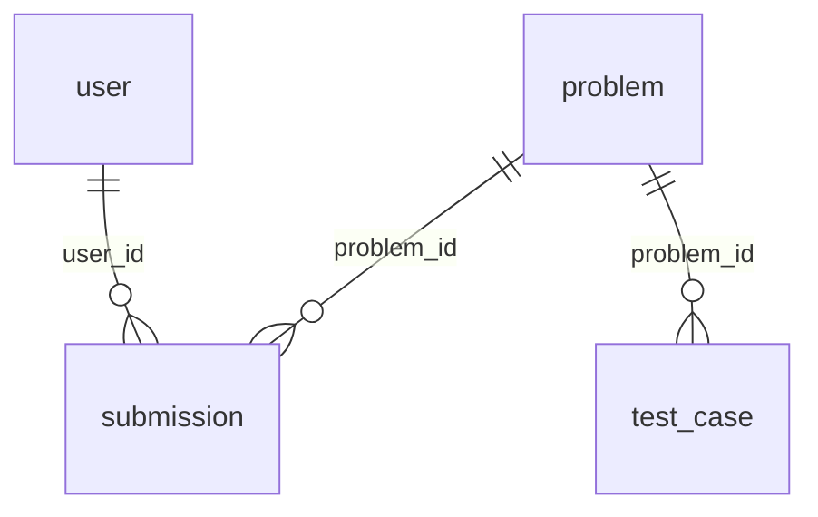
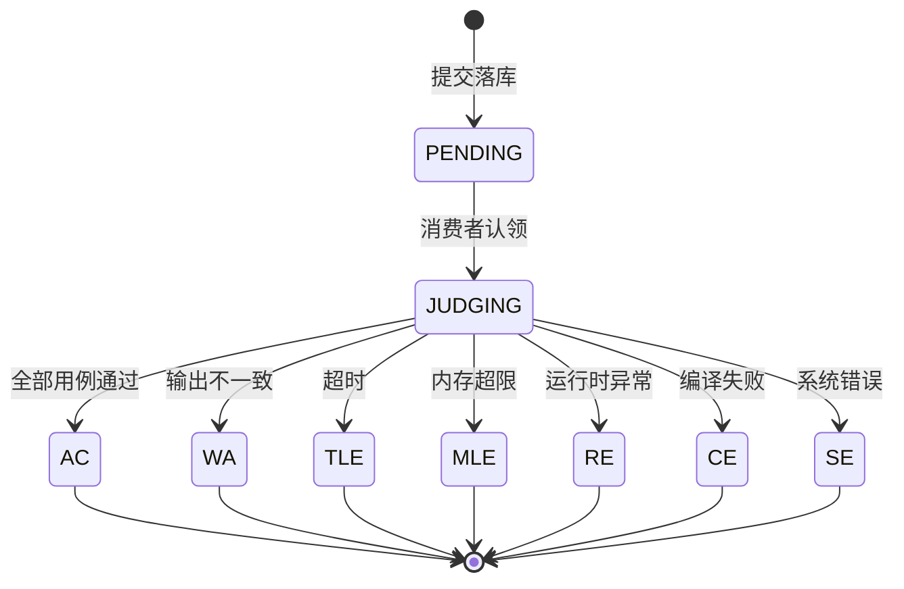

# 数据库设计

MySQL 8.0 / InnoDB / utf8mb4。四张表，**没有物理外键**——关联一致性由应用层事务保证，
理由在文末「关键取舍」里。

建表语句见 [`backend/sql/init.sql`](../backend/sql/init.sql)，示例数据见 `seed.sql`。

## 表清单

| 表 | 职责 | 增长量级 |
|---|---|---|
| `user` | 账号、角色、通过题数 | 万级 |
| `problem` | 题目主体，含题面大字段 | 千级 |
| `test_case` | 测试用例，挂在题目下 | 万级 |
| `submission` | 提交记录，系统里唯一高速增长的表 | 百万级 |

## ER 图

线是**逻辑关联**，库里没有 `FOREIGN KEY` 约束。

---

## user

| 字段 | 类型 | 说明 |
|---|---|---|
| `id` | BIGINT PK | 自增主键 |
| `username` | VARCHAR(32) | 唯一，登录名 |
| `password` | VARCHAR(100) | **BCrypt 哈希**，不是明文也不是 MD5 |
| `nickname` | VARCHAR(32) | 展示名，可空 |
| `role` | TINYINT | 0 普通用户 / 1 管理员 |
| `solved_count` | INT | 通过的题目数（**冗余计数**） |
| `create_time` / `update_time` | DATETIME | 建表时用 `DEFAULT CURRENT_TIMESTAMP`，不靠应用赋值 |
| `deleted` | TINYINT | 逻辑删除 |

索引：`uk_username` 唯一索引。登录查询 `WHERE username = ?` 直接命中，同时挡住重复注册。

---

## problem

| 字段 | 类型 | 说明 |
|---|---|---|
| `id` | BIGINT PK | |
| `title` | VARCHAR(100) | |
| `content` | MEDIUMTEXT | 题面，Markdown 原文 |
| `difficulty` | TINYINT | 1 简单 / 2 中等 / 3 困难 |
| `time_limit` | INT | 毫秒，默认 1000 |
| `memory_limit` | INT | MB，默认 256 |
| `submit_count` / `accept_count` | INT | 冗余计数，算通过率用 |
| `deleted` | TINYINT | 逻辑删除 |

索引：`idx_difficulty`。题目列表按难度筛选是高频入口。

> **`content` 是 MEDIUMTEXT，绝不能出现在列表查询里。**
> 一页 20 道题、每题题面几十 KB，`SELECT *` 会把网络和内存一起拖垮。
> 列表接口只查 `title / difficulty / submit_count / accept_count`，
> 题面在详情页按需单独取。

---

## test_case

| 字段 | 类型 | 说明 |
|---|---|---|
| `id` | BIGINT PK | |
| `problem_id` | BIGINT | 所属题目 |
| `input` / `output` | MEDIUMTEXT | 输入数据 / 期望输出 |
| `is_sample` | TINYINT | 1 = 示例用例（前端可见），0 = 隐藏用例 |
| `score` | INT | 该用例分值 |
| `sort_order` | INT | 展示与执行顺序 |

索引：`idx_problem(problem_id)`。判题时按题号一次性取出全部用例。

> `is_sample` 把"给用户看的样例"和"判题用的隐藏用例"放在同一张表，
> 靠标志位区分，而不是建两张表——两者结构完全一样，拆开只会让写入多一份事务。

---

## submission

| 字段 | 类型 | 说明 |
|---|---|---|
| `id` | BIGINT PK | |
| `request_id` | VARCHAR(64) | **前端生成的幂等键**，重试时复用 |
| `user_id` | BIGINT | 提交人 |
| `problem_id` | BIGINT | 题目 |
| `language` | VARCHAR(16) | JAVA / PYTHON |
| `code` | MEDIUMTEXT | 源码 |
| `status` | VARCHAR(16) | PENDING / JUDGING / AC / WA / TLE / MLE / RE / CE / SE |
| `score` | INT | 得分 |
| `time_cost` | INT | 最大用例耗时（ms） |
| `memory_cost` | INT | 峰值内存（KB） |
| `error_msg` | TEXT | 编译 / 运行错误 |
| `fail_case` | INT | 第一个失败用例序号 |
| `submit_time` | DATETIME | 提交时间 |
| `judge_time` | DATETIME | 判题完成时间 |

### 索引逐个说明

| 索引 | 服务的查询 | 为什么是这几列 |
|---|---|---|
| `uk_request_id(request_id)` | 幂等的最后一道防线 | 并发重复提交时数据库直接拒绝，不依赖应用层"先查后插" |
| `idx_user_time(user_id, submit_time)` | 「我的提交」`WHERE user_id=? ORDER BY submit_time DESC` | 两列顺序不能反：先按用户收窄，再按时间排序，**消除 filesort** |
| `idx_problem_status(problem_id, status)` | 题目维度的 AC 列表、通过率统计 | 先按题号定位，再按状态过滤 |
| `idx_status_submit(status, submit_time)` | 故障恢复任务：扫卡在 `JUDGING` 的提交 | 状态是低基数列，但配合时间范围后选择性足够 |

### 状态机

`PENDING` / `JUDGING` 是中间态，其余是终态。判题任务被重复投递时，
消费者用**条件更新**（`WHERE status IN ('PENDING','FAILED')`）抢占，影响行数为 1 才执行——
这样即使消息被 at-least-once 重复投递，也只有一次真正落结果。

---

## 关键取舍

### 1. 大字段与列表查询分离

`problem.content`、`test_case.input/output`、`submission.code` 都是 MEDIUMTEXT。
统一原则：**列表页永远不查这些列**。

这不是"以后优化"，是建表时就要定下来的边界——一旦有人写了 `SELECT *`，
后面加多少索引都救不回来。

### 2. 幂等靠唯一索引，不靠应用判断

`request_id` 唯一索引让数据库成为幂等的最终保证。
应用层"先查再插"在并发下必然有窗口：两个请求同时查不到，然后都插入。

捕获 `DuplicateKeyException` 后返回已有记录的 ID，比加分布式锁简单得多。

### 3. 冗余计数字段

`solved_count`、`submit_count`、`accept_count` 都是冗余的，理论上可以 `COUNT(*)` 算出来。

但排行榜和题目列表是最高频的页面，每次打开都全表聚合不现实。
代价是写入时多一次 `UPDATE`——判题完成本来就要更新 `submission.status`，
顺手在同一条语句里 `+1` 即可，没有额外成本。

### 4. 不加物理外键

`submission.user_id` 指向 `user.id`，但库里没有 `FOREIGN KEY`。

原因：
- 判题写入是高频路径，外键检查会带额外的意向锁，高并发下放大锁竞争
- 删除用户是逻辑删除（`deleted=1`），物理外键反而挡不住"逻辑上已删除"的引用
- 分库分表时外键必然要去掉，提前不用能少一次迁移

代价是脏数据可能写进来。所以写入路径的校验放在 Service 层：提交前先查 `user` 和 `problem` 是否存在。

### 5. 逻辑删除统一用 `deleted` 字段

`user` / `problem` 带 `deleted`，`submission` 不带——提交记录是审计数据，一旦产生就不该删。
MyBatis-Plus 的 `@TableLogic` 会自动在查询里拼 `deleted = 0`，业务代码不用反复写这个条件。
